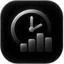

# TimeDay



TimeDay объединяет задачи, недельное расписание, таймер, секундомер и статистику приложений. Интерфейс построен на GTK 4 и поддерживает русский (RU), английский (EN) и украинский (UA).

## Возможности

- Задачи по дням, дедлайны и уведомления.
- Расписание с повторяющимися событиями и недельной сеткой.
- Таймер, секундомер и работа в системном трее.
- Статистика времени в фокусе и работы запущенных приложений.
- История сессий ПК с исключением времени сна.
- Локальное хранение данных и резервные копии SQLite.

## Требования

Linux, Python **3.10+**, GTK **4**. Основное окружение для проверки — Linux Mint с Cinnamon/X11. Для записи приложения в фокусе требуется X11; в Wayland доступен учёт запущенных процессов. Поддержка Windows и macOS не реализована.

Версию установленной копии можно посмотреть в настройках. Из каталога проекта её показывает команда `python3 -m timeday --version`. Интерфейс, трей и уведомления проверены в Linux Mint 22.3 с Cinnamon/X11.

## Установка и обновление на Linux Mint

Скачайте исходники через **Code → Download ZIP** на GitHub и распакуйте архив либо клонируйте репозиторий. Откройте терминал в папке с `install.py` и выполните:

```bash
sudo apt install python3 python3-gi python3-gi-cairo gir1.2-gtk-4.0 gir1.2-dbusmenu-glib-0.4 python3-xlib libx11-6 libxss1
python3 install.py
```

`sudo` нужен для установки системных зависимостей. Сам `install.py` запускается от обычного пользователя и устанавливает приложение в `~/.local/share/timeday/releases`, а ярлык меню — в `~/.local/share/applications` (или соответствующие каталоги `$XDG_DATA_HOME`). Установка через `pip` не требуется.

Откройте **TimeDay** из меню приложений. Для запуска из каталога проекта выполните `python3 -m timeday`. Чтобы обновить установленную копию, завершите TimeDay через `Ctrl+Q` и повторите `python3 install.py`. Обновление переводит включённую автозагрузку в режим запуска в трее. Установщик переключает ярлык после подготовки новой копии. При первом запуске после обновления со старой версии задачи с дедлайном попадут на дату дедлайна, а задачи без даты появятся в разделе «Сегодня». Завершённые задачи сохранят свой статус.

## Как пользоваться

- **Язык интерфейса.** Выберите RU, EN или UA на экране первого запуска либо в настройках. Перевод применяется сразу и сохраняется для следующих запусков. Названия задач, событий и приложений сохраняются в исходном виде. При смене языка работающие таймер и секундомер продолжают отсчёт.
- **Первый запуск.** Выберите, для чего будете использовать TimeDay. Варианты «Работа и задачи», «Учёба и расписание», «Концентрация» и «Статистика времени» задают раздел, который открывается при запуске. Галочки «Запускать при входе в систему» и «Создать ярлык на рабочем столе» включены по умолчанию. Кнопка «Начать работу» применяет выбор. В настройках автозагрузка управляется отдельным переключателем. Во время загрузки основного окна показывается экран с индикатором. Новые окна приветствия и приложения размещаются по центру экрана в Cinnamon/X11, а переключение языка обновляет текст в текущем окне.
- **Сегодня.** Стартовый экран показывает дату, ближайшее событие, задачи и три приложения, которыми сегодня пользовались дольше всего. Верхняя панель содержит название TimeDay со значком, текущий раздел, суммарное время работы ПК сегодня.
- **Расписание.** По умолчанию открыт список событий на сегодня. Выберите день в полосе дат, переключите неделю стрелками или нажмите диапазон дат для перехода через календарь. «Добавить событие» использует выбранный день. Щелчок по строке открывает редактор, где можно поменять дату или время. Недельная сетка доступна в соседней вкладке. Она подстраивается под высоту окна и показывает весь день от 00:00 до 23:59. Щелчок по свободному месту создаёт событие на выбранное время. Повторяющееся событие можно изменить или удалить отдельно либо вместе со всей серией. Если время окончания раньше начала, событие продолжится после полуночи.
- **Сессии ПК.** Откройте отдельную вкладку «Сессии ПК», чтобы увидеть суммарные часы работы за календарный месяц, график, среднее время по дням с данными и итоги по датам. Стрелки переключают месяц. «ПК сегодня» в верхней панели открывает быстрый итог за семь дней. Периоды до и после выключения складываются, а сон исключается. Данные о предыдущих запусках восстанавливаются из доступного системного журнала. Наблюдения TimeDay сохраняются в SQLite.
- **Планировщик.** Выберите «Сегодня», «Завтра» или «Предстоящие». Для произвольной даты используйте календарь. Длинные списки разделены на страницы по 50 задач. Быстрый ввод добавляет задачу на выбранный день. В редакторе доступны описание и время дедлайна. Флажок отмечает выполнение, а меню строки открывает редактирование, перенос или удаление. При переносе сохраняется время дедлайна.
- **Работа в фоне.** При входе в систему TimeDay запускается только в трее, без окна и экрана загрузки. Учёт времени и напоминания работают сразу. Обычный запуск из меню приложений или ярлыка открывает окно, в том числе если приложение уже работает в трее. Для фонового запуска вручную используйте `python3 -m timeday --background`. Закрытие окна скрывает TimeDay. Таймер, уведомления и мониторинг продолжают работать. Значок в системном трее Cinnamon открывает окно, а пункт **«Выйти»** полностью завершает приложение. Окно также можно вернуть через меню приложений. `Ctrl+Q` полностью завершает TimeDay.
- **Таймер и секундомер.** Используйте готовую длительность или задайте часы, минуты и секунды. «Старт», «Пауза», «Продолжить» и «Сбросить» управляют отсчётом. Секундомер поддерживает круги. При полном выходе сохранённый отсчёт открывается на паузе, от которой можно продолжить. Во время работы TimeDay сохраняет отсчёт примерно каждые 10 секунд. После принудительного завершения отсчёт можно продолжить с последней сохранённой точки.
- **Статистика.** Выберите день, неделю или месяц. Приложения с суммарным временем меньше 30 секунд за выбранный период скрыты из обзора, рейтинга и графиков. Исходные записи сохраняются; приложение появится после достижения 30 секунд. Полоса распределения показывает доли приложений, а строки рейтинга открывают данные конкретной программы. В недельном и месячном режимах можно выбрать день для хронологии. Переключатель «В фокусе / Запущено» меняет способ подсчёта. Режим «Запущено» включает фоновое время и показывает, какие приложения работают сейчас. Суммарная длительность может превышать время суток, когда несколько приложений работали одновременно. Иконки берутся из установленных ярлыков и системной темы.
- **Мониторинг.** Время в фокусе учитывает простой и блокировку Cinnamon. Время запуска определяется по процессам текущего пользователя и запущенным Flatpak с интервалом около двух секунд. Учитываются распознанные настольные приложения, включая свёрнутые и работающие без окна. Названия и иконки Steam-игр определяются по ID из локального каталога `appinfo.vdf`, библиотек, ярлыков и кэша Steam. Старые записи `Steam_app_…` тоже отображаются с найденными названиями. Для программ без подходящего системного значка TimeDay использует иконку окна X11 и сохраняет её в `$XDG_CACHE_HOME/timeday/icons` или `~/.cache/timeday/icons`. Режим «Запущено» исключает компоненты рабочего стола, службы и файловый менеджер, который может постоянно работать как часть окружения. История запуска начинается после обновления. Журнал хранит названия программ и интервалы.
- **Настройки.** Можно выбрать акцентный цвет, отключить анимации или мониторинг, изменить порог простоя и время напоминания. `Ctrl+N` открывает редактор новой задачи.

Для записи фокуса нужен сеанс **X11** с поддержкой EWMH. Учёт запущенных программ доступен также в Wayland, где распознавание опирается на имена процессов и Flatpak. Для значка в трее нужен апплет, поддерживающий StatusNotifier, например XApp Status в Cinnamon.

## Данные

Задачи, события, настройки и история приложений хранятся локально в `$XDG_DATA_HOME/timeday/timeday.sqlite3` или `~/.local/share/timeday/timeday.sqlite3`. Для статистики сохраняются названия приложений и интервалы времени. Базы данных и резервные копии не входят в исходники и исключены из Git через `.gitignore`.

## Ошибки и предложения

Откройте **Issues** в репозитории и выберите шаблон ошибки или предложения. Для ошибки укажите версию TimeDay, дистрибутив, рабочее окружение и X11/Wayland. Снимки экрана делайте с тестовыми данными.

Инструкции для разработки и pull request находятся в [CONTRIBUTING.md](CONTRIBUTING.md). GitHub Actions запускает тесты при push и pull request.

## Резервная копия и восстановление

В настройках откройте «Данные» и нажмите «Сохранить копию». TimeDay проверит целостность снимка и сохранит задачи, расписание, таймеры, статистику и настройки в одном файле SQLite. Приложение может продолжать работу во время копирования. Для копии укажите новое имя файла.

Из каталога проекта ту же операцию можно выполнить без запуска окна:

```bash
python3 -m timeday --backup "$HOME/TimeDay-backup.sqlite3"
```

Для восстановления:

1. Полностью завершите TimeDay через `Ctrl+Q` или «Выйти» в трее.
2. Откройте папку `$XDG_DATA_HOME/timeday` или `~/.local/share/timeday`, если `XDG_DATA_HOME` не задан. Переместите текущую `timeday.sqlite3` вместе с имеющимися файлами `timeday.sqlite3-wal`, `timeday.sqlite3-shm` и `timeday.sqlite3-journal` в отдельную папку. Это сохранит состояние до восстановления.
3. Скопируйте резервную копию в папку TimeDay под именем `timeday.sqlite3` и запустите приложение.

## Структура проекта

| Модуль | Назначение |
| --- | --- |
| `app.py`, `tray.py` | Жизненный цикл, навигация, уведомления и системный трей |
| `store.py` | SQLite, миграция и операции с данными |
| `activity.py`, `runtime.py`, `app_icons.py` | Фокус, процессы запущенных программ и системные иконки |
| `events.py`, `schedule.py` | Повторы, отдельные экземпляры и недельная сетка |
| `models.py`, `uptime.py`, `pc_sessions.py` | Таймеры, время работы ПК и календарная статистика |
| `planner.py`, `tasks.py` | Календарь, планировщик и редактор задач |
| `timers.py`, `dashboard.py` | Таймеры, обзор и статистика |
| `widgets.py`, `style.css` | Общие компоненты и оформление |

```bash
python3 -m unittest discover -s tests -v
```

## Лицензия

TimeDay распространяется под лицензией [MIT](LICENSE).
